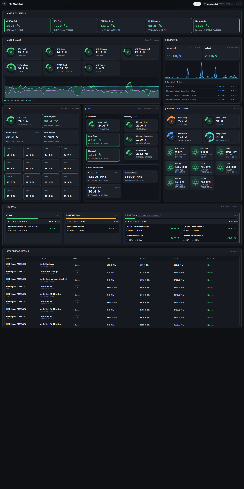

<div align="center">

# PC Monitor

**Live, detailed hardware telemetry for Windows—without a separate monitoring server or a heavyweight desktop stack.**

[](https://github.com/BrainAlaw/LibreHWMonitor-Dashboard/actions/workflows/ci.yml)
[](https://github.com/BrainAlaw/LibreHWMonitor-Dashboard/releases/latest)
[](https://github.com/BrainAlaw/LibreHWMonitor-Dashboard/releases)
[](LICENSE)
[](#installation)

**[Download for Windows](https://github.com/BrainAlaw/LibreHWMonitor-Dashboard/releases/latest)**
· [Features](#features) · [Installation](#installation) · [Configuration](#configuration) · [Contributing](#contributing)



*One glance for system load, temperatures, cooling, network activity, power estimates, storage, and the complete sensor matrix.*

</div>

## See what your PC is doing

PC Monitor turns hardware readings into a live, readable dashboard. It runs as a Windows tray application, collects telemetry in the background, and serves its dashboard locally. The UI is bundled into the app: download it, launch it, and your system data stays on your machine unless you deliberately enable LAN access.

### Dashboard showcase

The screenshot above is the actual dashboard, not a mock-up:

| View | What it helps you inspect |
|---|---|
| **Overview** | Major temperatures and loads, recent trends, and network throughput |
| **CPU and GPU** | Utilization, temperatures, clocks, memory, and available power readings |
| **Power and cooling** | Measured CPU/GPU package power, configurable wall-power estimate, and fan speeds |
| **Storage** | Volume capacity and usage, associated drives, activity, and drive temperatures where available |
| **Raw sensor matrix** | Searchable-at-a-glance sensor readings, identifiers, ranges, and health details |

> **More screenshots or a live demo?** The full-height image above shows the current interface. A short capture of the dashboard updating in real time would be a useful addition; no demo GIF is included yet.

## Features

- **Live telemetry:** Updates the dashboard through server-sent events instead of polling from every UI component.
- **Broad hardware coverage:** CPU, GPU, memory, motherboard, storage, network, battery, PSU, and controller sensors through LibreHardwareMonitor.
- **Useful detail without clutter:** Dedicated hardware views plus an optional raw sensor matrix; configurable fan display and power-estimate assumptions.
- **A lightweight deployment:** A self-contained, single-file Windows executable with the dashboard embedded—no separate Node.js, .NET runtime, browser install, or LibreHardwareMonitor app required.
- **Native when available:** WebView2 window, system-tray controls, fullscreen mode, and browser fallback when the WebView2 Runtime is unavailable.
- **Designed for the background:** Close to tray, optional start-minimized behavior, live tray summary, and optional elevated start-at-logon task.
- **Local by default:** Binds to loopback and validates the Host header. Optional LAN access is restricted to private networks and protected by a generated token.
- **Transparent diagnostics:** Health status reports telemetry limitations; logs are retained locally for seven days.
- **Reproducible releases:** Windows CI runs the UI and backend tests. Tagged releases include an installer, portable ZIP, and SHA-256 checksums.

## Installation

**Supported platform: Windows 10 or Windows 11, x64.** PC Monitor is not currently supported on macOS or Linux.

### Option 1: Installer

1. Open [the latest GitHub release](https://github.com/BrainAlaw/LibreHWMonitor-Dashboard/releases/latest).
2. Download `PCMonitor-Setup-<version>.exe` and run it.
3. Choose optional Start Menu/desktop shortcuts and, if desired, the start-at-logon task.
4. Launch PC Monitor. Approve the elevation prompt for the broadest sensor coverage.

### Option 2: Portable

1. Download `PCMonitor-<version>-portable.zip` from [Releases](https://github.com/BrainAlaw/LibreHWMonitor-Dashboard/releases).
2. Extract it to a folder you can write to.
3. Run `PCMonitor.exe`; approve elevation for full sensor access.

The executable is self-contained. The **Microsoft Edge WebView2 Runtime** is needed for the native window and is already present on Windows 11 and systems with current Edge. If it is missing, PC Monitor offers to open the local dashboard in your default browser instead.

### First launch and sensor access

**CPU and motherboard sensors also require [PawnIO](https://pawnio.eu).** Install the driver from its official site, then restart PC Monitor. Administrator rights alone do not replace this dependency. The installer detects missing PawnIO registration and offers an optional download link; the portable app reports the limitation under System status. PC Monitor does not install the driver automatically. Driver registration does not prove successful driver access or support for every sensor.

The LibreHardwareMonitor driver and some hardware sensors need elevated access. Without Administrator privileges, the app still starts, but health may show `degraded` and some CPU, motherboard, fan, or voltage readings may be unavailable. A first hardware initialization can take up to about 35 seconds; the dashboard shows a starting state while it initializes. If driver access is blocked, check the health details and local logs.

### Missing measurements

1. Open **System status**. Missing PawnIO, missing CPU temperature, missing motherboard telemetry and individual device update failures are reported even when other sensors work.
2. Install PawnIO if indicated and restart PC Monitor. If it is installed, check driver access and whether the same CPU or board works in the official LibreHardwareMonitor app using the same library revision.
3. Choose **Download diagnostic report** on the monitored PC. Review hardware names/identifiers before attaching it to an issue with the CPU/board model, BIOS version and Windows version. Compare the raw matrix with the CPU summary: a raw reading missing from the summary suggests selection; a missing/unavailable raw reading suggests collection, access or hardware support.

Failed device updates preserve healthy devices and retry on later polls; failed devices do not publish stale measurements as fresh readings. Detected sensors with unavailable values remain in the raw matrix. Slow devices retain their last completed snapshot between background updates. CPU temperature labels use the sensor's own name, including Intel package and AMD Tctl/Tdie names. Estimated CPU power stays marked as an estimate and is excluded from measured package-power totals.

## Usage

- Double-click the tray icon to show or restore the dashboard. Launching a second copy focuses the already-running instance.
- Closing the window hides it in the tray by default; change **Close to tray** in Settings if you prefer different behavior.
- Use the tray menu to open, toggle fullscreen, reload the dashboard, reset telemetry, manage start-at-logon, open the dashboard in a browser, copy a LAN link, open logs, or exit.
- The **status** control in the dashboard summarizes out-of-range readings and telemetry problems. The **settings** control opens display, fan, and power-estimate options.
- The network total includes physical adapters; virtual adapters are shown separately and are not summed.
- Display and power-estimate preferences are stored per browser. App settings are stored locally by Windows user.

## Configuration

Most app settings are available in the dashboard and saved automatically. The settings file is `%APPDATA%\PCMonitor\settings.json`.

<details>
<summary>App settings and defaults</summary>

| Setting | Default | Details |
|---|---:|---|
| `Port` | `8096` | Dashboard/API port. If busy, the app tries the next available port, up to 19 ports later. Restart to apply. |
| `SamplingMs` | `1000` | Sensor polling interval, from 250 to 60,000 ms; applies live. |
| `StartMinimized` | `false` | Start in the system tray. |
| `CloseToTray` | `true` | Hide the window instead of exiting when it is closed. |
| `AllowLan` | `false` | Allow token-protected access from private networks; restart to change the server bind address. |
| `AccessToken` | Generated when needed | LAN access token. Use **New token** in Settings to invalidate existing links. |
| `EnableCpu`, `EnableGpu`, `EnableMemory`, `EnableMotherboard`, `EnableStorage`, `EnableNetwork`, `EnableBattery`, `EnablePsu`, `EnableController` | `true` | Enable hardware groups. Use **Reset telemetry** in the tray menu to reinitialize hardware after changing them. |

For a one-run port override in PowerShell:

```powershell
$env:PORT = "8096"
.\PCMonitor.exe
Remove-Item Env:PORT
```

`PORT` overrides the saved port for that run and is not written to `settings.json`.

**Start with Windows** creates a Scheduled Task named `PCMonitor`, triggered at logon with highest privileges. This allows the task to start elevated without prompting for UAC at every logon. The installer can create this task if you select its optional autostart task.

Logs are written to `%APPDATA%\PCMonitor\logs\` and retained for seven days. For UI development, a built dashboard in `%APPDATA%\PCMonitor\ui\` overrides the embedded UI.

</details>

<details>
<summary>Optional LAN access and security</summary>

LAN access is **off by default**. Enable **Allow LAN access** in Settings (or set `AllowLan` in `settings.json`) and restart PC Monitor.

- The server listens on network interfaces and adds a program-based Windows Firewall rule for the Private profile.
- Only private-network clients and recognized LAN hostnames are accepted. Public clients are denied even if they present a token.
- Each LAN viewer needs the access token. Use the link provided in Settings or choose **Copy LAN link** in the tray menu. The token is exchanged for an HttpOnly cookie and removed from the address bar.
- LAN viewers can view the dashboard but cannot access app settings. Generating a new token invalidates previous links.
- LAN traffic uses **plain HTTP, not TLS**. Use this feature only on trusted networks. The token is stored in the local settings file; protect that file accordingly.

By default, the server binds only to loopback and rejects unexpected Host headers to reduce DNS-rebinding risk. Do not expose the service to the public internet.

</details>

<details>
<summary>Local HTTP API</summary>

The API listens on the same local port as the dashboard (default `8096`).

| Endpoint | Description |
|---|---|
| `GET /api/snapshot` | Latest snapshot with `timestamp`, `hardware[]`, `sensors[]`, and `volumes[]`. Sensor records include ID, device/path, group, type, value, min/max, unit, and display precision. Unavailable/non-finite readings remain with `value: null`. Throughput values are in bytes per second (`B/s`). Returns `503` while the first sample is pending. |
| `GET /api/stream` | Server-sent events: `snapshot` for each published sample, `health` when health changes, and heartbeat comments. |
| `GET /api/health` | Status (`starting`, `ok`, `degraded`, or `error`), elevation, hardware count, `sensorCount` (detected), `availableSensorCount` (readable), `problems[]`, last error/update, `driver` (PawnIO registration/version/detection error), port, and version. |
| `GET /api/diagnostics` | Local-only JSON download containing OS/library version, health, enabled CPU/board/GPU groups, hardware and readings. Excludes settings tokens, network adapters and volume labels. Review hardware names/identifiers before sharing. |
| `GET /api/settings` | Local-only settings, including whether autostart is enabled and LAN URLs when LAN access is on. |
| `PUT /api/settings` | Local-only, same-origin JSON patch for supported settings. Port and LAN bind changes may require a restart. |

Example in PowerShell:

```powershell
Invoke-RestMethod http://127.0.0.1:8096/api/health
Invoke-RestMethod http://127.0.0.1:8096/api/snapshot
```

Settings writes are restricted to loopback clients and same-origin JSON requests. LAN access does not grant remote settings access.

</details>

## Development

Builds and tests require the **.NET 10 SDK** and **Node.js 22+**. Windows is required for the app and Windows integration tests.

```powershell
# Install frontend dependencies and run the dashboard checks
Push-Location ui
npm ci
npm run typecheck
npm test
Pop-Location

# Run backend unit and integration tests
dotnet test tests\PCMonitor.Tests -c Release

# Publish the self-contained executable (builds and embeds the dashboard)
dotnet publish src\PCMonitor -c Release -o publish
```

For dashboard development, run `npm run dev` from `ui`. Vite proxies `/api` to a running PC Monitor instance at `127.0.0.1:8096`.

The optional hardware smoke test exercises the published executable and expects an elevated shell:

```powershell
.\tools\smoke-test.ps1 -ExePath .\publish\PCMonitor.exe
```

Use `-AllowNonElevated` when intentionally testing without elevation. To compare sensor coverage against the official LibreHardwareMonitor web server:

```powershell
.\tools\compare-telemetry.ps1 `
  -Reference http://127.0.0.1:8085/data.json `
  -Candidate http://127.0.0.1:8096/api/snapshot
```

The UI source is in `ui/`; its Vite build output in `src/PCMonitor/wwwroot/` is generated and ignored. The .NET project builds the UI before embedding it. CI runs UI typechecking/tests and backend tests on Windows.

## Roadmap

Project priorities evolve with hardware coverage and community feedback. Potential areas of future work—not release commitments—include:

- Improve sensor identification and compatibility reporting across more motherboard and controller combinations.
- Expand hardware-based regression coverage for devices and readings that cannot be reliably represented by mocks.
- Add practical examples and integrations for consumers of the local HTTP/SSE API.

Have a specific use case or hardware issue? [Open an issue](https://github.com/BrainAlaw/LibreHWMonitor-Dashboard/issues) with your Windows version, hardware model, PC Monitor version, and relevant health/log details. Remove personal or sensitive information before sharing logs.

## Contributing

Contributions are welcome. Before opening a pull request:

1. Search existing issues and pull requests; open an issue first for substantial behavior changes.
2. Keep changes focused and preserve the loopback-only default, LAN token requirements, and single-file runtime model.
3. Add or update tests for changed behavior. Run `npm run typecheck`, `npm test`, and the relevant `dotnet test` suite; run both layers for API or cross-layer changes.
4. Update the README when installation, settings, API behavior, or user-facing limitations change.
5. Describe the problem, implementation, test results, and any hardware/elevation checks that could not be performed in the pull request.

Please do not include generated `wwwroot`, `publish`, `bin`, `obj`, or `node_modules` output in commits.

## Known limitations

- **Windows 10/11 x64 only.** macOS and Linux are not supported.
- CPU and motherboard coverage depends on PawnIO installation, permitted driver access and LibreHardwareMonitor support for the CPU/board. Missing enabled CPU temperature or motherboard readings produces `degraded` health; available telemetry continues working. See System status, logs and the diagnostic report.
- Some generic motherboard Super I/O readings (for example, `Temperature #N` under `/lpc/`) do not have a confirmed component mapping. They remain available in the raw sensor matrix as **Unidentified sensor; alerts disabled** and do not trigger temperature alerts. This avoids labeling potentially unused inputs as overheating; it does not establish whether a reading is physically valid. This includes the readings reported on the ASUS TUF GAMING B550-PLUS in [issue #1](https://github.com/BrainAlaw/PC-Monitor/issues/1). Named motherboard, CPU, GPU, and drive temperature alerts remain enabled.
- The project currently uses pre-release `LibreHardwareMonitorLib 0.9.7-pre705`. SATA drives may be identified as `/ahci/N` rather than `/ssd/N`; some NVMe `Level` sensors reported by 0.9.6 are not present.
- First-run hardware initialization can take up to about 35 seconds while native components are extracted and the driver initializes.
- A wall-power figure is an estimate based on configurable assumptions. Only CPU and GPU package power are measured directly.

## License and attribution

PC Monitor is released under the [MIT License](LICENSE). See [THIRD_PARTY_NOTICES.md](THIRD_PARTY_NOTICES.md) for bundled components and their licenses.
